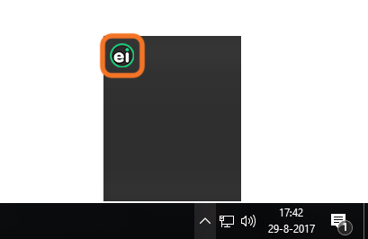
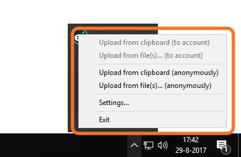
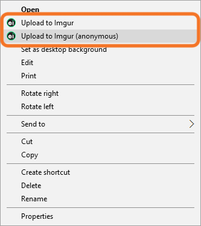
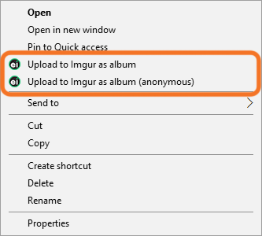
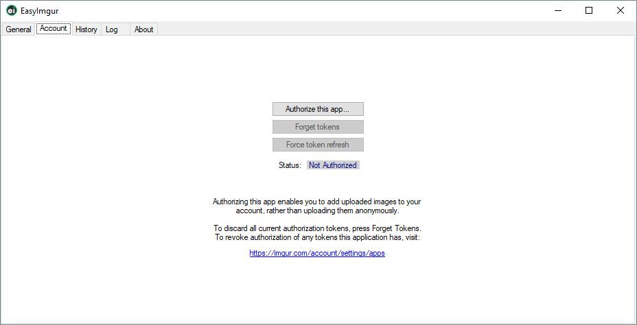
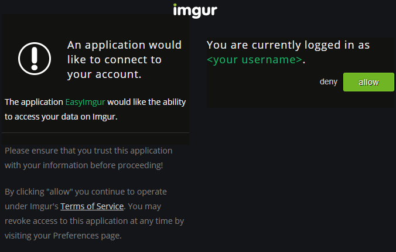
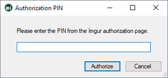
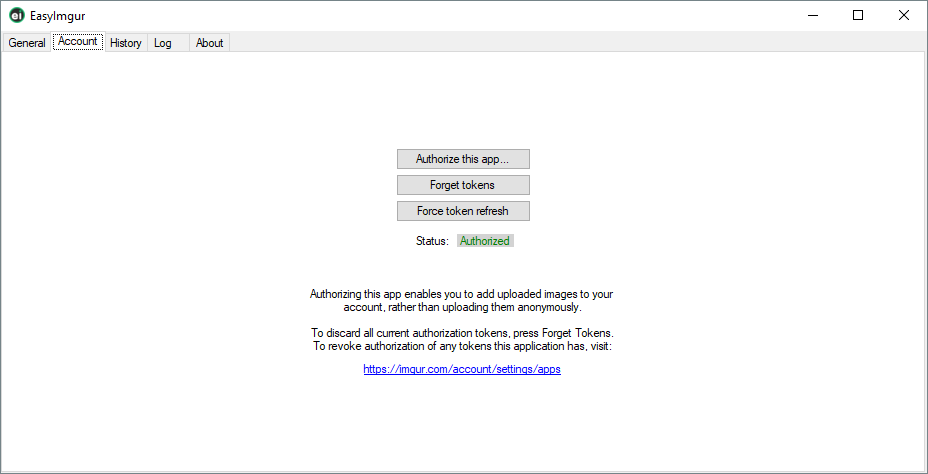
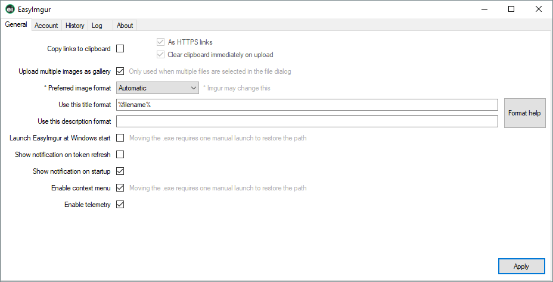
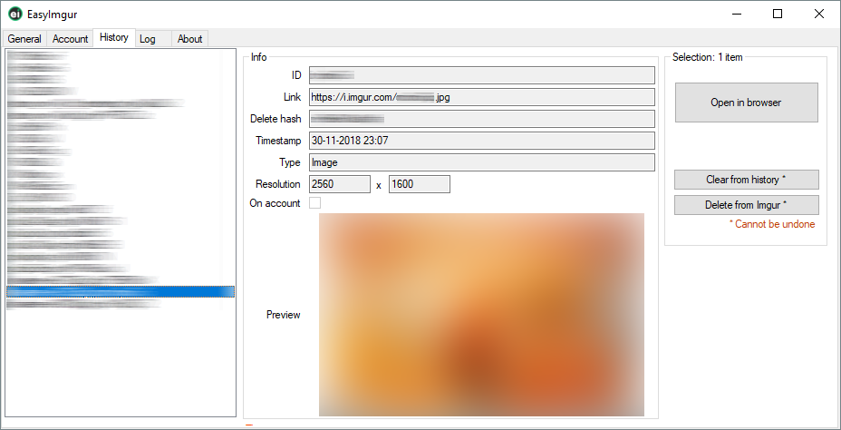

#  EasyImgur

EasyImgur is a small and simple tool to easily upload images to imgur.com from your desktop.

## Table of Contents

* [Using EasyImgur](#using-easyimgur)
  * [Downloading and running](#downloading-and-running)
  * [Uploading from the tray](#uploading-from-the-tray)
  * [Uploading with the explorer context menu](#uploading-with-the-explorer-context-menu)
* [Using EasyImgur to upload images to your Imgur account](#using-easyimgur-to-upload-images-to-your-imgur-account)
* [Viewing uploaded images](#viewing-uploaded-images)
* [Settings](#settings)
* [Running in portable mode](#running-in-portable-mode)
* [Command Line Parameters](#command-line-parameters)

## Using EasyImgur

### Downloading and running

1. [Download EasyImgur](https://github.com/bkeiren/EasyImgur/releases) (zip archive) and extract its contents to a folder.
2. Run **EasyImgur.exe**. The EasyImgur icon appears in your system tray:

   

> [!TIP]
> The first time you run EasyImgur, it registers itself to start automatically with Windows. You can turn this off with the **Launch EasyImgur at Windows start** setting.

### Uploading from the tray

Right-click the tray icon to open the EasyImgur menu:

| Menu option | What it uploads |
|---|---|
| **Upload from file...** | An image file you pick, uploaded anonymously. |
| **Upload from clipboard** | The image or image URL on your clipboard (a screenshot or a copied link, for example), uploaded anonymously. |
| **Upload from file... (to account)** | Same as above, but to your Imgur account. Requires [authorization](#uploading-to-your-imgur-account). |
| **Upload from clipboard (to account)** | Same as above, but to your Imgur account. Requires [authorization](#uploading-to-your-imgur-account). |

### Uploading from File Explorer

You can also upload images, or folders of images, straight from the File Explorer context menu.

> [!NOTE]
> These options only appear after you tick **Enable context menu** in the settings.

**To upload a file**, right-click it and select **Upload to Imgur** or **Upload to Imgur (anonymous)**:

**To upload a folder as an album**, right-click it and select **Upload to Imgur as album** or **Upload to Imgur as album (anonymous)**. All images directly inside the folder are uploaded into a single album. Images in subfolders are **not** included.

## Uploading to your Imgur account

To upload images to your own Imgur account, you first need to authorize EasyImgur to access it.

1. Right-click the EasyImgur tray icon and select **Settings**. In the window that opens, go to the **Account** tab:

   

2. Select **Authorize this app...**. Imgur's authorization page opens in your browser. If you're already logged in, you'll see this:

   

3. Select **Allow**, then copy the code shown on the next page.

4. Switch back to EasyImgur, where a popup is now waiting for the code:

   

   Paste the code and select **OK**. EasyImgur may appear unresponsive for a moment while it receives authorization from Imgur.

5. A notification confirms that authorization succeeded, and the Account tab now shows **Status: Authorized**:

   

6. You can now use the **(to account)** upload options in the tray menu.

> [!WARNING]
> **Forget Tokens** in EasyImgur only discards the codes stored on your computer. It does not revoke EasyImgur's access. If you suspect someone has gained access to your tokens, revoke access on Imgur's [app settings page](https://imgur.com/account/settings/apps), where you can manage every app connected to your account.

> [!NOTE]
> EasyImgur periodically refreshes its authorization with Imgur and shows a notification each time it does (or if it fails). You can turn these notifications off with the **Show notification on token refresh** setting.

## Viewing uploaded images

The **History** tab lists everything you've uploaded, along with each image's URL and details. From there you can:

- Open an image's link in your browser.
- Delete an image from Imgur.
- Remove an image from your local history (it stays on Imgur).

## Settings

EasyImgur has a number of different customizable settings. These can be accessed from the *General* tab in the EasyImgur settings window:

| Setting | Description |
|---|---|
| **Copy links to clipboard** | Determines whether links to images that have successfully been uploaded are automatically placed on your clipboard (ready to be pasted somewhere with Ctrl+V). |
| **As HTTPS links** | Determines whether uploaded image links will be put on the clipboard as HTTPS links or HTTP links (if possible at all). |
| **Clear clipboard immediately on upload** | Determines whether the clipboard will be cleared after uploading from it. |
| **Upload multiple images as gallery** | Determines whether multiple images uploaded using the file dialog window are uploaded as separate images or contained in an album. |
| **Preferred image format** | This option gives a hint to Imgur as to what image format is preferred. Note that it only hints at this by providing the source image in a certain format. Imgur can (and sometimes will) change the format to something else if it chooses to do so. |
| **Use this ... format** | These define two strings that are used as the title and description for every uploaded image. The strings can contain special symbols which are converted to set values before uploading. For a complete set of symbols, click the *Format help* button.  **Example:** the format `Image_%n%_%date%_%time%` produces the title `Image_0_19-08-2013_13:37:00`. Here `%n%` is converted to an integer denoting how many images have currently been uploaded, `%date%` is converted to the current date in DD-MM-YYYY format, and `%time%` is converted to the current time in HH-MM-SS format. |
| **Launch EasyImgur at Windows start** | This determines whether EasyImgur should have a registry key set to allow it to be started when Windows is started. Note that if you move the EasyImgur.exe file, the registry path will become incorrect and a manual start of EasyImgur is required to restore it (EasyImgur detects this and can take care of that when it starts). |
| **Show notification on token refresh** | If you have authorized EasyImgur to use your Imgur account, it can notify you each time it refreshes its authentication tokens. Enabling this option will allow EasyImgur to show a balloon tooltip pop up from your icon tray each time it refreshes its tokens. |
| **Show notification on startup** | EasyImgur will by default show a notification when it starts up to let you know it's ready for use. You can disable this from the settings tab. |
| **Enable context menu** | This option determines whether the following options are added to the file context menu (right click menu) to allow even easier uploading: • Upload to Imgur • Upload to Imgur (anonymous) |
| **Enable telemetry** | This option determines whether EasyImgur will send telemetry data regarding how it's being used. This data is used to determine how we can improve EasyImgur. |

## History

Your EasyImgur upload history is on the **History** tab of the settings window. To open it, right-click the EasyImgur tray icon, select **Settings**, then go to the **History** tab:

From the History tab you can:

- Browse a list of all your uploads
- See a preview and details for each upload
- Delete uploads from Imgur

## Running in portable mode

EasyImgur can be run in portable mode to allow you to take your settings and account authorization tokens with you on (for example) a USB drive! To run EasyImgur in portable mode simply start it with the command line switch `/portable`:

    EasyImgur.exe /portable

In portable mode your history, logs, and settings are saved to the local EasyImgur.exe folder.

## Command Line Parameters

Please refer to [the wiki](https://github.com/bkeiren/EasyImgur/wiki/Command-Line-Parameters) for a list of supported command-line parameters.
